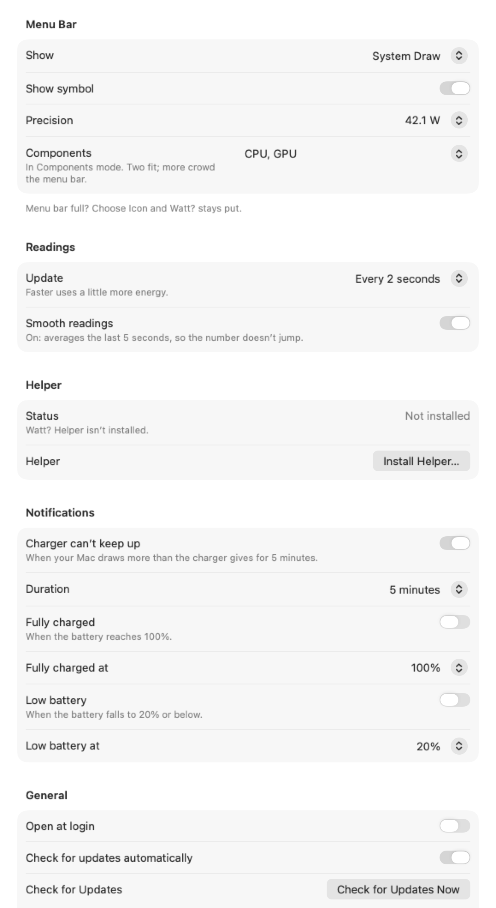

<p align="center">
  
</p>

<h1 align="center">Watt?</h1>

<p align="center">Native macOS menu-bar app that shows live charger, system and battery power in watts.</p>

<p align="center">
  <a href="https://github.com/ben-ranford/watt/releases/latest"></a>
  <a href="https://github.com/ben-ranford/watt/releases"></a>
  
  <a href="LICENSE"></a>
</p>

<p align="center">
  <picture>
    <source media="(prefers-color-scheme: dark)" srcset="docs/screenshots/panel-dark.png">
    
  </picture>
</p>

Watt lives in the menu bar. Open it for the charger, what the Mac is drawing, and whether the battery is filling or emptying. It is free, and it does not limit the charge. A desktop, with no battery to fill, shows the draw on its own.

## Install

macOS 13 or later.

### Homebrew

```sh
brew install --cask ben-ranford/tap/watt
```

The cask comes from [ben-ranford/homebrew-tap](https://github.com/ben-ranford/homebrew-tap).

### Download

Download the zip or the disk image from [GitHub Releases](https://github.com/ben-ranford/watt/releases/latest), move Watt into Applications, and open it.

## Features

<p align="center">
  <picture>
    <source media="(prefers-color-scheme: dark)" srcset="docs/screenshots/menu-bar-dark.png">
    
  </picture>
</p>

- System draw in the menu bar. You can switch that to battery, charger, CPU and GPU, or the icon on its own.
- The panel names the adapter, and its rated wattage, when the Mac reports them.
- Time to full, or time remaining on battery, when macOS provides an estimate.
- Notifications if the charger cannot keep up, the battery is full, or it is running low.

<p align="center">
  <picture>
    <source media="(prefers-color-scheme: dark)" srcset="docs/screenshots/settings-dark.png">
    
  </picture>
</p>

How often the number updates, and whether Watt opens at login, is in Settings.

If charging looks slow, [Why is my Mac charging slowly?](https://ben-ranford.github.io/watt/why-is-my-mac-charging-slowly.html) walks through the same rows. A [comparison](https://ben-ranford.github.io/watt/compare.html) with Stats, AlDente, coconutBattery, and iStat Menus is on the site.

## FAQ

### Does it limit charging?

No. To hold the battery at a percentage, use AlDente or Charge Limit in Battery settings. Watt shows the numbers.

### Why does it ask for a helper?

The charger, system, and battery readings work without one. CPU and GPU need it. Setup asks for your password once, then macOS asks you to allow the helper in Login Items & Extensions. Skip it if you do not want those two. Homebrew does not install the helper, and you can remove it later in Settings.

### Does it send my readings anywhere?

No. They stay on the Mac. The helper reads CPU and GPU power locally. If update checks are left on, Watt downloads an update notice and does not upload your readings. There is no analytics. Settings can turn the checks off.

## Support

Watt is free. [GitHub Sponsors](https://github.com/sponsors/ben-ranford) is there if you want to support development.

Bugs and questions go in [GitHub issues](https://github.com/ben-ranford/watt/issues). To build from source, see [Contributing](CONTRIBUTING.md).

## Licence

[MIT](LICENSE) © 2026 Benjamin Ranford
