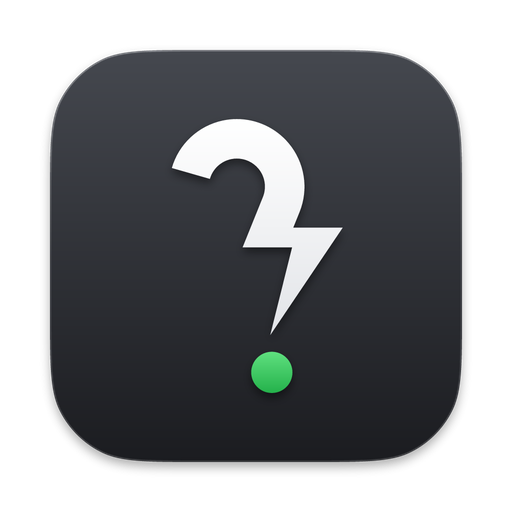
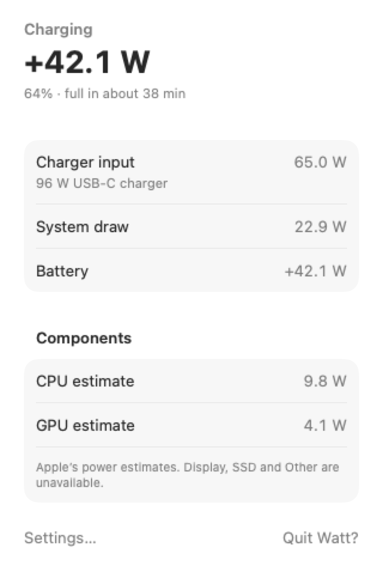

<p align="center">
  
</p>

<h1 align="center">Watt?</h1>

<p align="center">Native macOS menu-bar app that shows live charger, system and battery power in watts.</p>

<p align="center">
  <a href="https://github.com/ben-ranford/watt/releases/latest"></a>
  <a href="https://github.com/ben-ranford/watt/releases"></a>
  
  <a href="LICENSE"></a>
</p>

<p align="center">
  <picture>
    <source media="(prefers-color-scheme: dark)" srcset="docs/screenshots/panel-dark.png">
    
  </picture>
</p>

Watt lives in your menu bar and shows where your Mac's power is going: what the charger is supplying, what the Mac is drawing, and whether the battery is filling or emptying. It's free and open source, and it never touches your charging.

## Install

Requires macOS 13 or later.

### Homebrew

```sh
brew install --cask ben-ranford/tap/watt
```

The cask comes from [ben-ranford/homebrew-tap](https://github.com/ben-ranford/homebrew-tap).

### Download

Or grab the latest `.dmg` from [Releases](https://github.com/ben-ranford/watt/releases/latest) and drag Watt into Applications.

## Features

<p align="center">
  <picture>
    <source media="(prefers-color-scheme: dark)" srcset="docs/screenshots/menu-bar-dark.png">
    
  </picture>
</p>

- Live system draw in the menu bar, or switch to battery, charger, CPU/GPU, or just the icon
- Optional battery percentage in the menu bar, next to the watts or on its own, and a battery icon that follows the charge
- See which charger is plugged in and its rated wattage
- Time to full, or time left on battery
- Optional alerts when your charger can't keep up, the battery's full, or it's running low
- Light and dark mode, launch at login, adjustable refresh rate

<p align="center">
  <picture>
    <source media="(prefers-color-scheme: dark)" srcset="docs/screenshots/settings-dark.png">
    
  </picture>
</p>

Charging feeling slow? [Here's how to tell why](https://ben-ranford.github.io/watt/why-is-my-mac-charging-slowly.html). Wondering how Watt stacks up against Stats, AlDente and iStat Menus? [See the comparison](https://ben-ranford.github.io/watt/compare.html).

## FAQ

### Does it limit charging?

No. Watt just shows the numbers. If you want to cap your charge, use AlDente or the Charge Limit option in Battery settings.

### Can I use it from Shortcuts?

Yes. Shortcuts can read the current sample, open the panel or Settings, and change the menu-bar display. The manual check is [docs/shortcuts.md](docs/shortcuts.md).

### Why does it ask for a helper?

Only for CPU and GPU readings. Everything else works without it. If you want those, setup asks for your password once and macOS asks you to allow it in Login Items. You can skip it, or remove it later in Settings.

### Does it send my readings anywhere?

No. Everything stays on your Mac and there's no analytics. The only network request is the update check, which you can turn off in Settings.

## Support

Found a bug or have an idea? [Open an issue](https://github.com/ben-ranford/watt/issues). If you'd like to chip in, [GitHub Sponsors](https://github.com/sponsors/ben-ranford) is appreciated but never expected.

Want to build it yourself? See [CONTRIBUTING.md](CONTRIBUTING.md).

## Licence

[MIT](LICENSE) © 2026 Benjamin Ranford
