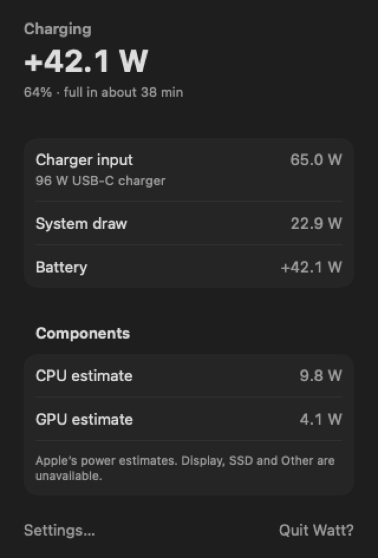
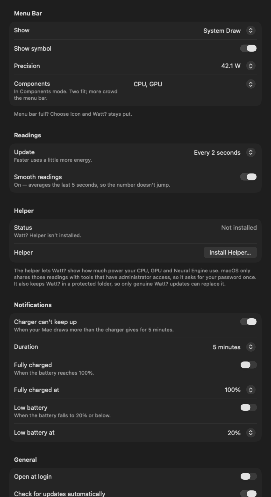

# watt

The menu bar, the panel, and Settings. Light appearance, then dark. `SiteScreenshotTests` renders these from the SwiftUI views with sample power readings.

| | Light | Dark |
| --- | --- | --- |
| Menu bar |  |  |
| Panel |  |  |
| Settings |  |  |

[](https://github.com/RichardLitt/standard-readme)
[](https://github.com/ben-ranford/watt/actions/workflows/ci.yml)
[](LICENSE)

Native macOS menu-bar power monitor, built in SwiftUI

This repository, its folder, and the Homebrew cask are named `watt`. The Swift package in `Package.swift` is named `Watt`. The running app's display name is Watt?.

Watt? sits in the menu bar and shows what the Mac is drawing or charging, in watts. Click the status item for a short power panel. The secondary-click menu and Settings choose the reading, optional CPU and GPU estimates, notifications, and helper access.

## Table of Contents

- [Security](#security)
  - [Privileged helper](#privileged-helper)
  - [Developer ID signing](#developer-id-signing)
  - [Update verification](#update-verification)
  - [Reporting a vulnerability](#reporting-a-vulnerability)
- [Background](#background)
- [Install](#install)
  - [Dependencies](#dependencies)
  - [Homebrew](#homebrew)
  - [Download](#download)
  - [Updating](#updating)
- [Usage](#usage)
- [Build](#build)
- [Support](#support)
- [Maintainers](#maintainers)
- [Contributing](#contributing)
- [License](#license)

## Security

Releases are signed with Developer ID Application and notarised. A root helper supplies Apple's CPU and GPU power estimates. The app accepts an update only after it checks an Ed25519 signature and the archive digest. Apple's signature is not the update check.

### Privileged helper

`WattHelper` (`io.github.ben-ranford.watt.helper`) is a launch daemon. The administrator installer places the binary at `/Library/PrivilegedHelperTools/io.github.ben-ranford.watt.helper` and its launchd plist at `/Library/LaunchDaemons/io.github.ben-ranford.watt.helper.plist`. That plist sets `UserName` to `root`. `WattHelperInstaller` does not take privilege itself. An administrator runs it, and macOS then asks you to approve Watt? Helper in Login Items & Extensions.

The helper's sampler runs one fixed command, `/usr/bin/powermetrics` with `-f plist -n 1 -i 1000 -s cpu_power,gpu_power`. It does not accept an executable, arguments, or paths from the app. CPU and GPU estimates appear only when both are available. Display, SSD, and Other are unavailable. Battery delta, charger input, and system draw come from IOKit power sources and do not need the helper.

A fresh install does not register the helper by itself. Setup and Settings offer **Install Helper…**, which runs the bundled `WattHelperInstaller` and asks for an administrator password. `SMAppService` daemon registration does not write the exact code-hash pins the helper requires, so the app does not use that API for this path. The installer still checks the preflight digest against the staged bytes before it writes anything. Homebrew does not install the helper during `brew install`; the cask only places `Watt.app` in Applications.

Release builds set `WATTHelperTrustMode` to `protected-installation` by expanding `$(WATT_HELPER_TRUST_MODE)` in the app and helper Info.plist before signing. The local Apple Development configuration sets that build setting to `certificate`. The app selects certificate trust only when the compiled value is exactly `certificate`. The helper's XPC requirement is the installed app's cdhash. It does not trust every ad-hoc signature that carries the bundle identifier. A missing or stale pin rejects the caller. It is not replaced with a team requirement or an identifier-only requirement. After an update, that pin changes only when the administrator installer has checked the Ed25519 manifest and the archive SHA-256, or through the reviewed helper-update flow. Both restart the helper with the new record. Certificate trust is the local Apple Development configuration. Distribution preflight rejects it.

Administrator commands, protected paths, and recovery are in [HelperInstaller/README.md](HelperInstaller/README.md).

### Developer ID signing

Release archives are signed with the Developer ID Application certificate for team `GUT4TJFVQ2`, the hardened runtime, and a secure timestamp. Nested tools (`WattHelper`, `WattMaintenance`, `WattHelperInstaller`) are signed with that same identity before the app bundle. The app is notarised, and the ticket is stapled to `Watt.app` before the zip, the disk image, and the update tar are packed. The disk image is signed, notarised, and stapled as its own container. A zip cannot carry a staple of its own; the ticket travels inside the app.

Gatekeeper accepts that download. There is no Control-click step.

The Homebrew cask does not remove `com.apple.quarantine`. A stapled notarised app launches with that attribute set.

Local Debug builds stay ad-hoc (`CODE_SIGN_IDENTITY=-`) so they can be built without the Developer ID certificate. The HelperSigned configuration is still the local Apple Development setup.

The helper's XPC requirement stays the installed app's cdhash. It is not replaced with a team requirement. Developer ID puts the team in the code directory, so the cdhash changes on the first signed release even when the rest of the binary would have matched. The in-app updater already rotates that pin after the Ed25519 manifest and the archive SHA-256 check. Replacing `Watt.app` by hand, without that installer, leaves the helper rejecting the new hash until **Install Helper…** runs again.

Open at login uses `SMAppService` on the main app. An ad-hoc designated requirement is the cdhash, and the Developer ID designated requirement is the team certificate, so the first launch of a signed build can ask you to allow Watt in Login Items. Later updates keep the same team, so that prompt is once. Notification permission is also tied to the signing identity and can be asked again once. Watt does not request Accessibility or any other TCC permission, and it does not store keychain items.

### Update verification

The app reads two HTTPS URLs from its Info.plist. Release builds fill `$(WATT_UPDATE_MANIFEST_URL)` and `$(WATT_UPDATE_ARTIFACT_URL)` from `Resources/ReleaseIdentity.json`:

- `https://ben-ranford.github.io/watt/updates/manifest.json`
- `https://ben-ranford.github.io/watt/updates/Watt.tar`

GitHub Pages publishes both files together. The manifest is a `SignedUpdate`: base64 `payload` and base64 `signature`. The payload is the compact JSON `UpdateManifest` (`identity`, `build`, `sha256`, `minimumSystemVersion`, optional `notes`, and optional `rollout`). The signature is Ed25519 over those exact payload bytes. The app checks it with the public key built into that release. The private key is not in this repository. A client that does not know `rollout` still verifies the signature and ignores that field.

A manifest is accepted only when the signature is valid, `identity` is `io.github.ben-ranford.watt`, `build` is a positive integer newer than the installed build, `minimumSystemVersion` is a `MAJOR.MINOR[.PATCH]` version this Mac can run, and the SHA-256 of `Watt.tar` matches `sha256`. A staged `rollout` then keeps an automatic check to the signed cohort. The cohort is a random number stored on this Mac. It is not sent anywhere. **Check for Updates** skips that schedule. A halted release is not offered, and a critical one is offered to every install. Update URLs must be `https`, with no user, password, query, or fragment. Redirects are allowed only when the host stays the same, and only up to three of them. The updater reads the uncompressed ustar of `Watt.app`. The zip and the disk image are downloads for people. They are not the update artifact.

The release flow is described in [RELEASING.md](RELEASING.md).

### Reporting a vulnerability

Report a vulnerability privately through [GitHub Security Advisories](https://github.com/ben-ranford/watt/security/advisories/new). Do not put exploit details in a public issue. If that form is unavailable, contact [@ben-ranford](https://github.com/ben-ranford) and ask for a private channel before sending details.

## Background

Watt? is a native SwiftUI menu-bar utility (`LSUIElement`). It exists to show Mac power in watts from the status item: battery delta, charger input, and system draw, plus optional CPU and GPU estimates.

System readings come from IOKit. Public power-source descriptions omit live watt telemetry. Measured battery, charger, and system watts are read from `AppleSmartBattery` registry properties when the hardware exposes them, and the parser fails closed when it does not. The charger row adds the adapter’s rated wattage and name from `AdapterDetails` or `IOPSCopyExternalPowerAdapterDetails`. Time to full and time remaining come from the IOPS time keys when that estimate is a real duration. Missing, zero, and still-calculating values are left out. CPU and GPU estimates are a separate path. They come from `powermetrics`, which the root helper runs. The menu bar can show at most two components, and only CPU and GPU. Display, SSD, and Other are not provided.

See also [RELEASING.md](RELEASING.md) for how a release is signed and published, and [HelperInstaller/README.md](HelperInstaller/README.md) for the administrator installer.

## Install

### Dependencies

Watt requires macOS 13.0 or later. The deployment target, the Swift package, and the release check all use that minimum (`LSMinimumSystemVersion` `13.0`, Homebrew `depends_on macos: :ventura`).

Building from source needs Xcode with the macOS SDK. Continuous integration runs on the Xcode 27 image because `WattTests` references `NSMenuItem.preferredImageVisibility`, which the macOS 27 SDK declares. Running the installed app does not require Xcode.

### Homebrew

The cask `watt` is published from [ben-ranford/homebrew-tap](https://github.com/ben-ranford/homebrew-tap).

```sh
brew install --cask ben-ranford/tap/watt
```

The cask downloads `Watt-X.Y.Z.zip` from GitHub Releases and installs `Watt.app`. It sets `auto_updates true`, so Homebrew leaves upgrades to Watt. `brew upgrade` does not replace the app unless you pass `--greedy`. The cask moves when a rollout is complete or the release is critical, not while a staged rollout is still in progress. New installs during a rollout get the last complete version, then follow the in-app schedule. The cask rendered for the next signed release does not strip quarantine. A cask published from an older ad-hoc release still has that step until this release replaces it.

### Download

Download `Watt-X.Y.Z.zip` or `Watt-X.Y.Z.dmg` from the [GitHub Releases](https://github.com/ben-ranford/watt/releases) page, move Watt into Applications, and open it. The build is Developer ID signed and notarised, so Gatekeeper accepts the first launch.

### Updating

**Check for Updates…** is in the secondary-click menu, and **Check for Updates Now** is in Settings. Both use the signed-manifest updater and both skip a staged rollout. Automatic checks start on, follow the signed schedule, and Settings can turn them off. Up to date and couldn’t-check results use the existing update window. The app downloads the signed manifest and `Watt.tar` described under [Update verification](#update-verification). With no privileged-helper record, it replaces its own bundle. With a helper record, the administrator installer rotates that installation after it checks the same manifest and archive digest, then restarts the helper. The ready window says Watt? quits, updates, and comes back to the menu bar, in about 5 seconds.

The first launch after that update shows **What’s New** once, using the signed release notes. The app remembers that the window appeared as soon as it is shown, so closing the Mac without pressing Done does not bring it back. A fresh install does not show it. The same notes stay available from **What’s New** in the About panel.

## Usage

Launch the installed app:

```sh
open -a Watt
```

Watt? has no Dock icon. Click the menu-bar item for the power panel. The charger row shows measured input, and names the adapter and its rated wattage when the Mac reports them. Time to full, or time remaining on battery, is added to the summary only when that estimate is valid. Secondary-click the menu-bar item for the menu:

- **Show in Menu Bar** chooses System Draw (the default for a new install), Battery Delta, Charger Input, Per Component, or Icon Only. System Draw is the useful number on a Mac that is plugged in and holding its charge, which is the usual first-run state; Battery Delta stays one menu away. Per Component stays off until the helper is approved and both CPU and GPU estimates are available. Icon Only keeps the item in place when the menu bar is full.
- **Open Watt?** opens the panel. **Settings…** (Command-,) opens settings. **About Watt?**, **Check for Updates…**, and **Quit Watt?** (Command-Q) are on the same menu.

Settings can set the reading, whether a symbol is shown, precision (`42 W`, `42.1 W`, or `42.10 W`), the update interval (every second, every 2 seconds, or every 5 seconds), and smooth readings. Smooth readings average the last 5 seconds. Notifications cover a charger that cannot keep up (5 minutes by default), a full charge (100% by default), and a low battery (20% by default, off until you turn it on). Settings can change the charger duration and both percentages. Open at login is off until you turn it on, in setup or in Settings. Component readings, when the helper is connected, are CPU and GPU only. An idle battery flow on AC, including a held charge, shows as `0.0 W` with the panel title Not charging. It is not a missing reading.

## Build

From the repository root:

```sh
xcodebuild -project Watt.xcodeproj -scheme Watt -configuration Debug -destination 'platform=macOS' build
```

The Swift package is the development harness for the same sources:

```sh
swift build
swift test
```

`scripts/configure-release-identity.py` applies a reviewed bundle identifier and build number. `scripts/verify-release-readiness.sh` checks one built `.app` without publishing it. Administrator installation of the privileged helper is described in [HelperInstaller/README.md](HelperInstaller/README.md).

## Support

Watt is free and open source. [GitHub Sponsors](https://github.com/sponsors/ben-ranford) is there for anyone who wants to support development.

## Maintainers

[@ben-ranford](https://github.com/ben-ranford)

## Contributing

Questions and bug reports go in [GitHub issues](https://github.com/ben-ranford/watt/issues). Pull requests are welcome. Open one against `main`. The issue forms, the pull request template, and the checks that run before merge are in [CONTRIBUTING.md](CONTRIBUTING.md).

This repository uses [Conventional Commits](https://www.conventionalcommits.org/en/v1.0.0/) because [Release Please](https://github.com/googleapis/release-please) cuts releases from them. `fix:` is a patch, `feat:` is a minor, and `feat!:` or `BREAKING CHANGE` is a major. `ci:` and `chore:` do not bump the version. The release steps are in [RELEASING.md](RELEASING.md).

## License

[MIT](LICENSE) © 2026 Benjamin Ranford
