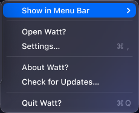
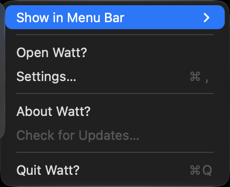
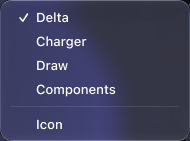
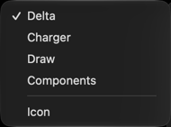

# C03 independent-comparison handoff

Incoming score: user-supplied 84/100. The latest independent Visual Ralph-style
review of the public ScreenCaptureKit screen-region captures scored **64/100
FAIL**. Production rendering now uses native public minimum-width metrics to
match the Figma component bounds; no custom row or painted chrome was added.

| Exact reference crop (1x) | Fresh native derivative (2x compositor capture → explicit 1x) |
| --- | --- |
|  |  |
|  |  |

Raw ScreenCaptureKit captures: `screencapturekit/sck-screen-0.png` and
`screencapturekit/sck-screen-1.png`; desktop-independent captures are retained
as `screencapturekit/sck-menu-*.png`. Reference full export:
`reference-22-1095.png`. Derivation: `capture-screencapturekit.sh` and explicit
1x `sips` derivatives; no masks, recoloring or compositing.
Diagnostic overlays/diffs and JSON are siblings. Hashes: `independent-review-assets.json`.

Confirm parent blue-selected, Delta idle checked, native text/insets/material against
reference. Current gaps are readily visible: near-black instead of blue-gray,
missing reference border, heavier text, separator insets and a dimmed disabled
Check for Updates… row. Matching exact bounds and passing behavior tests are not
visual acceptance. ScreenCaptureKit now proves a supported compositor path for
the app-owned rectangles, but it does not prove status-item placement or AX.

Rejected feasibility probe: `custom-view-experiment/{native,custom}.json`, raw PNGs,
`probe.swift`, and `run.sh`. Labels/effect views are native, not bitmap facsimiles;
none is linked into Watt. Trial screenshots deliberately show missing standard
indicators rather than redrawing them to conceal the native-behavior failure.

The independent review verdict is FAIL at 64/100; no visual pass is claimed.
