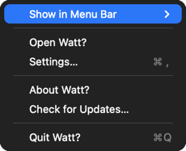
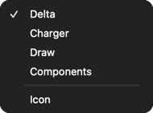

# C03 independent-comparison handoff (not an independent verdict)

Incoming score: user-supplied 84/100. No new score. Production rendering unchanged.

| Exact reference crop (1x) | Fresh native derivative (2x cache → explicit 1x) |
| --- | --- |
|  |  |
|  |  |

Raw captures: `native-menu-0.png`, `native-menu-1.png`. Reference full export:
`reference-22-1095.png`. Derivation: `compare.sh`; no masks, recoloring or compositing.
Diagnostic overlays/diffs and JSON are siblings. Hashes: `independent-review-assets.json`.

Confirm parent blue-selected, Delta idle checked, native text/insets/material against
reference. Current gaps are readily visible: near-black instead of blue-gray,
missing reference border, heavier text, separator insets. Matching dimensions and
passing behavior tests are not visual acceptance. CacheDisplay is not a compositor
screenshot and does not prove real desktop blending or status-item placement.

Rejected feasibility probe: `custom-view-experiment/{native,custom}.json`, raw PNGs,
`probe.swift`, and `run.sh`. Labels/effect views are native, not bitmap facsimiles;
none is linked into Watt. Trial screenshots deliberately show missing standard
indicators rather than redrawing them to conceal the native-behavior failure.

Independent verdict remains pending: this executor cannot spawn an independent
reviewer. Review assets are supplied without claiming an independent score or pass.
